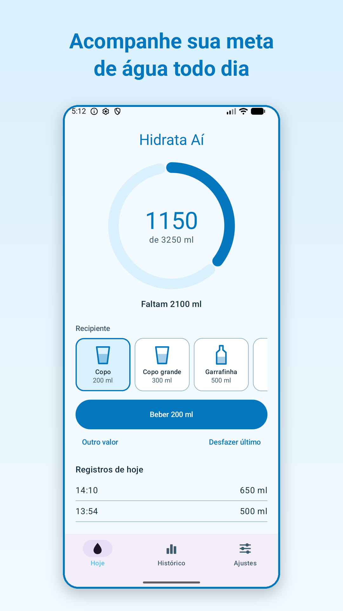
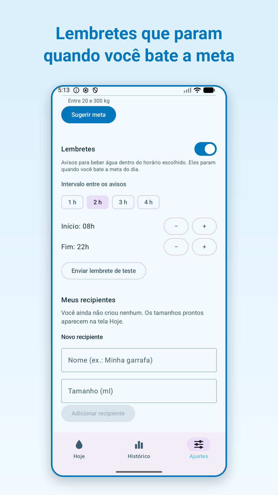
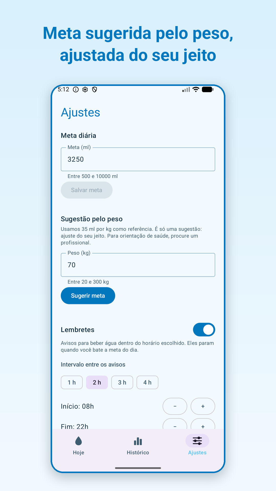

# Hidrata Aí

Aplicativo Android para acompanhar o consumo diário de água. Você escolhe o recipiente (copo ou garrafa), toca em **Beber** e acompanha o progresso da meta do dia, o histórico da semana e lembretes ao longo do dia.

Projeto de portfólio, feito do zero em **Kotlin** com **Jetpack Compose**.

## Capturas de tela

<table>
  <tr>
    <td align="center" width="33%">
      <br>
      <b>Tela Hoje</b>
    </td>
    <td align="center" width="33%">
      <br>
      <b>Lembretes e recipientes</b>
    </td>
    <td align="center" width="33%">
      <br>
      <b>Meta e peso</b>
    </td>
  </tr>
</table>

### Tela Hoje

O círculo mostra quanto da meta do dia já foi bebido e quanto ainda falta. Abaixo dele, a lista de recipientes (copo, copo grande, garrafinha, garrafa e os que você criar): escolha um e toque em **Beber** para registrar. Também dá para digitar **outro valor** em ml ou **desfazer o último** registro. No fim da tela ficam os registros do dia, com horário e quantidade.

### Lembretes e recipientes

Nos Ajustes, o interruptor liga os lembretes de água. Você escolhe o intervalo entre os avisos (1, 2, 3 ou 4 horas) e o horário de início e de fim, para não ser avisado fora do seu dia. O botão **Enviar lembrete de teste** mostra como a notificação aparece. Os lembretes param sozinhos quando a meta do dia é atingida. Mais abaixo, você cria os seus próprios recipientes, com nome e tamanho em ml.

### Meta e peso

A meta diária é sua: digite o valor em ml e salve. Se preferir uma sugestão, informe o peso (kg) e o app calcula uma referência de 35 ml por kg. É só um ponto de partida, e você pode ajustar do seu jeito. O peso fica guardado apenas no aparelho.

## Funcionalidades

- **Meta diária** personalizável, com sugestão opcional pelo peso (35 ml por kg).
- **Recipientes**: copos e garrafas prontos, e a possibilidade de criar os seus (nome e tamanho).
- **Registro rápido**: escolha o recipiente e toque em Beber, ou digite outro valor. Também é possível desfazer o último registro.
- **Histórico** dos últimos 7 dias, com gráfico de barras, média diária e dias em que a meta foi batida.
- **Lembretes** com intervalo (1 a 4 horas) e janela de horário configuráveis. Eles param quando a meta do dia é atingida.
- **Funciona offline** e sem conta. Os dados ficam só no aparelho.

## Tecnologias

- Kotlin e Jetpack Compose (Material 3)
- ViewModel e StateFlow
- Room (banco de dados local)
- WorkManager (lembretes agendados) e notificações
- Gráficos e ícones desenhados com `Canvas`, sem bibliotecas externas
- Testes unitários com JUnit

## Como o código está organizado

A lógica de negócio fica em funções puras, sem dependência do Android, e é coberta por testes unitários:

| Arquivo | Responsabilidade |
|---|---|
| `Agua.kt` | meta sugerida pelo peso, fração da meta, quanto falta |
| `Tempo.kt` | início do dia e tempo até a virada do dia |
| `Historico.kt` | totais por dia, média e dias que bateram a meta |
| `Lembretes.kt` | horários dos lembretes e regra de quando avisar |
| `Validacao.kt` | validação de valores digitados |
| `Recipiente.kt` | tipos e tamanhos de recipientes |

As telas (`TelaHoje`, `TelaHistorico`, `TelaAjustes`) e os ViewModels ficam separados da lógica.

## Como rodar

Requisitos: Android Studio recente e um emulador ou celular com Android 8.0 (API 26) ou mais novo.

1. Clone o repositório.
2. Abra a pasta no Android Studio e aguarde a sincronização do Gradle.
3. Execute o app (botão ▶).

Para rodar os testes unitários:

```
./gradlew test
```

No Windows, use `gradlew.bat test`.

## Privacidade

O app não coleta nem envia dados. Veja a [Política de Privacidade](PRIVACY.md).

## Contato

agua@denisviana.com.br